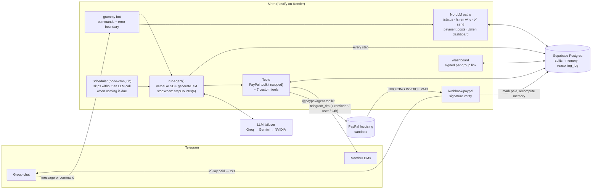

# Siren

**An autonomous payment agent for Telegram groups.** Tell Siren "/split €24 pizza with Jay, Sean and Mike" and it plans the whole job: it works out who owes what, creates a PayPal invoice for each person, DMs them their own pay link, watches PayPal for payments and posts "✅ Jay paid" when the money lands. Nobody has to chase anyone, because Siren does it: a scheduled runner lets the agent decide on its own **whether, who and how** to remind. It remembers how each member pays (fast and reliable → a chill nudge; always late → a direct one), never nags anyone more than once a day, and shows its real reasoning with `/siren why`.

Submitted to the **PayPal AI Hackathon 2026**: *Agentic Commerce* + *Best Use of PayPal + AI*.

<!-- Demo GIF: record and drop at docs/demo.gif, then replace this comment with:  -->
> 🎬 **Demo video:** _link added before submission_

---

> ### 🧰 Built on [PayPal Agent Toolkit](https://github.com/paypal/agent-toolkit)
> Every outbound PayPal call (create, send, get, remind, cancel invoices) goes through the official `@paypal/agent-toolkit/ai-sdk` tools. Siren hand-rolls exactly one PayPal call: verifying incoming webhook signatures, which the toolkit doesn't cover.

---

## Agent architecture



**How one decision happens:** a message (or the scheduler) calls `runAgent()`. The Vercel AI SDK's `generateText` *is* the agent loop: the model reads the group's context (members, open splits, reliability scores, recent decisions), calls tools, reads their results and decides the next step, for at most 6 steps. Every step (thought, tool calls, results, tokens, model) is saved to `reasoning_log`, which is exactly what `/siren why` and the dashboard show.

**What the LLM is never trusted with:** money facts and guardrails live in code. Amounts in DMs are replaced with the real share from the database, the pay link is appended by code, the ✅ card is the only way invoices go out, payments post without an LLM, and every rate limit and group boundary is enforced inside the tool handlers.

## Tool catalogue

### PayPal tools (from [`@paypal/agent-toolkit`](https://github.com/paypal/agent-toolkit), [docs](https://developer.paypal.com/tools/agent-toolkit/))
- `create_invoice`, `send_invoice`: called from code after the creator taps ✅ (`src/paypal/split_invoices.ts`), one invoice per person, `send_to_recipient: false` so the payer link goes out by Telegram DM.
- `get_invoice`: the agent checks an invoice's status (summarised to the fields it needs).
- `send_invoice_reminder`: PayPal's own reminder email, under the same 1-per-user-per-24h limit as Telegram reminders.
- `cancel_sent_invoice`: the agent cancels an invoice when a split is called off.

Every toolkit tool the agent can see is wrapped by `src/agent/tools/paypal_scoped.ts`: it only accepts invoices that belong to this group's splits. `list_invoices`, orders, subscriptions and disputes are deliberately not exposed; listing would show the whole merchant account across groups.

### Custom tools (`src/agent/tools/`)
- `send_split_invoices`: drafts a split from natural language ("€24 pizza with Jay, Sean and Mike") and shows a ✅/❌ card. Nothing is sent until the creator taps ✅.
- `telegram_dm`: DMs one member their pay link or a reminder in their tone. Refuses paid members, other groups' members and a second reminder within 24h.
- `get_member_profile`: a member's reliability, average time to pay, preferred tone and what they owe now.
- `fetch_group_history`: past splits in this group, with who paid and how fast.
- `remember_preference`: saves something a member said ("remind me on Fridays", a tone).
- `schedule_followup`: the agent picks when to look at a split again instead of nagging early.
- `summarise_debt`: net balances across the group's open splits (who owes whom, after cancelling out).

## PayPal APIs used
- **Invoicing v2** via the Agent Toolkit: create, send (payer-view link), get, remind and cancel.
- **Webhooks**: `INVOICING.INVOICE.PAID` and `INVOICING.INVOICE.CANCELLED`, verified against PayPal's certificate (`src/paypal/webhooks.ts`). A payment posts to the group and updates the payer's memory with no LLM involved.
- Orders is not used: a split is a set of invoices (one per person), and the toolkit's orders tools are USD-only.

## AI stack
- **[Vercel AI SDK](https://ai-sdk.dev)** (`ai` v7): `generateText({ tools, stopWhen: stepCountIs(6) })` is the whole agent loop.
- **Groq** `openai/gpt-oss-120b` as the primary model, failing over to **Gemini** `gemini-3.5-flash`, then **NVIDIA NIM** `nemotron-3-ultra`, when a provider's quota runs out (`src/llm/failover.ts`). Groq's per-minute limit is waited out; its daily limit triggers the switch.
- **Prompt layout built for caching:** a byte-identical system prompt and tool list on every call, with everything per-call (time, group state, the message) in the user turn. Cached tokens are recorded per step.
- **Memory:** reliability = 0.6 × on-time ratio + 0.4 × speed score, recomputed from real payment history after every payment and every scheduler pass. The tone follows from it (> 0.8 chill, 0.4–0.8 neutral, < 0.4 direct) unless the member set one with `/siren tone`.
- **Autonomy:** every 6 hours the scheduler looks at open splits. If nothing is due (a follow-up scheduled for later, everyone reminded in the last 24h) it skips **without** calling the LLM; otherwise the agent decides whether to remind, who, and in what tone.

## Setup for judges

The live bot runs on PayPal **sandbox**, so no real money moves.

1. **Add Siren to a group:** open **[t.me/siren_pay_bot?startgroup=true](https://t.me/siren_pay_bot?startgroup=true)** and pick (or create) a group. Add at least one other person.
2. **Everyone** opens a private chat with [@siren_pay_bot](https://t.me/siren_pay_bot), presses **Start**, then says "hi" in the group. Start lets Siren DM you; "hi" registers you as a group member so names can be matched.
3. **Try it in the group:**
   - `/split €24 pizza with Jay and Sean` (use your group members' first names) → tap ✅ on the card. Each person gets a DM with their own PayPal link.
   - Pay a link while logged in to one of the sandbox buyer accounts below → within about a minute the group shows "✅ … paid".
   - `/status` · `/siren debt` · `/siren about <name>` · `/siren tone chill` · `/nag`
   - `/siren why` shows the agent's last decision: its real steps, tool calls and results.
   - `/siren dashboard` DMs you a private 24h link to the group's dashboard (members, splits, every agent decision).

**Sandbox buyer accounts** (PayPal sandbox Personal accounts; log in on the pay link's `sandbox.paypal.com` page):

| Account | Password |
|---|---|
| `jay@sandbox.test` | in the Devpost testing notes |
| `sean@sandbox.test` | in the Devpost testing notes |
| `mike@sandbox.test` | in the Devpost testing notes |

Never use a real PayPal login on a sandbox link (it won't work anyway). The free LLM tiers allow roughly 25 agent replies a day per provider; if Siren says its AI quota is used up, the deterministic commands (`/status`, `/siren why`, ✅, payments) still work.

**Run it yourself:** follow *Local development* below with your own PayPal sandbox app, Telegram bot and Supabase project. `SETUP.md` walks through each.

| Env var | What it is |
|---|---|
| `PAYPAL_CLIENT_ID`, `PAYPAL_CLIENT_SECRET` | PayPal sandbox REST app (Invoicing feature on) |
| `PAYPAL_MODE` | `sandbox` |
| `PAYPAL_WEBHOOK_ID` | the webhook you register for `/webhook/paypal` |
| `TELEGRAM_BOT_TOKEN` | from @BotFather, with privacy mode **disabled** |
| `GROQ_API_KEY`, `LLM_PROVIDER`, `LLM_MODEL` | primary LLM |
| `GOOGLE_GENERATIVE_AI_API_KEY`, `GEMINI_MODEL` | fallback 1 |
| `NVIDIA_API_KEY`, `NVIDIA_MODEL` | fallback 2 |
| `SUPABASE_URL`, `SUPABASE_SERVICE_KEY` | database (`SUPABASE_DB_URL` only for `npm run db:push`) |
| `NAG_CRON_INTERVAL` | scheduler cron, default every 6h (`*/5 * * * *` for a demo) |
| `PUBLIC_URL` | production only: the service's own URL (Telegram webhook mode). Blank locally = long polling |

## Local development

Requires Node 22+ and the [Supabase CLI](https://supabase.com/docs/guides/cli).

```bash
git clone https://github.com/DamianCiumacenco/siren-paypal-hackathon.git && cd siren-paypal-hackathon
npm install
cp .env.example .env.local   # fill in values (see SETUP.md)
npm run db:push              # apply src/db/schema.sql to Supabase
npm run db:check             # verify the tables exist
npm run dev                  # Fastify + Telegram bot (long polling when PUBLIC_URL is blank)
```

| Command | What it checks |
|---|---|
| `npm run typecheck && npm test` | ~260 unit and route tests, no network |
| `npm run test:startup` | boots the real server for 15s and checks `/health` and a clean shutdown |
| `npm run test:pii` | logs contain no names, amounts or message text |
| `npm run paypal:sanity` | creates and cancels a real sandbox invoice through the toolkit |
| `npm run agent:live -- --scenario <name>` | runs the real agent against the sandbox and checks its guardrails |
| `npm run verify:live -- <url>` | 9 checks against a deployment (health, DB, webhooks, dashboard) |
| `npm run test:e2e` | the 7 success criteria end to end against the live URL (real PayPal, LLM and DB; Telegram captured) |

## Project structure

```
src/
├── agent/          runAgent (the loop), system prompt, reasoning log
│   └── tools/      7 custom tools + paypal_scoped.ts (wraps the toolkit's tools)
├── bot/            grammy setup, error boundary, /status, /siren why, /siren dashboard, ✅/❌ cards
├── paypal/         toolkit init, per-person invoices, webhook signature verification
├── memory/         reliability scoring, tone picker, recompute on payment
├── scheduler/      autonomous runner (node-cron)
├── llm/            Groq → Gemini → NVIDIA failover, rate-limit handling
├── dashboard/      signed per-group links, dashboard data (same redaction as the bot)
├── routes/         /webhook/telegram, /webhook/paypal, /health, /dashboard
├── db/             Supabase queries + schema.sql
├── lib/            money formatting, safe error logging, chat lock
└── server.ts       wires it all together
public/             dashboard page (AG Grid Community)
scripts/            db push/check/reset, sandbox + live checks
test/               unit tests; test/e2e/ = one file per success criterion
```

`ARCHITECTURE.md` has the full design: data model, flows, guardrails and what each milestone measured.

## Deployment

`render.yaml` is a Render Blueprint: Dashboard → New → Blueprint → pick the repo. It creates one free Node 22 web service in Frankfurt (next to Supabase in Dublin) that runs `npm ci` and `npm start`, health-checks `/health`, and redeploys on every push to `main`. Secrets are marked `sync: false`, so you enter them in the Render dashboard and they never live in the repo.

After the first deploy:
1. Set `PUBLIC_URL` to the service's own `https://….onrender.com` URL. Siren then registers its Telegram webhook (with a secret header) instead of long polling.
2. In the PayPal app, add a webhook for `https://….onrender.com/webhook/paypal` with "Invoicing invoice paid" and "Invoicing invoice cancelled", and put its id in `PAYPAL_WEBHOOK_ID`.
3. Point an UptimeRobot monitor at `/health` every 5 minutes. Free instances sleep after 15 idle minutes, and the ping keeps the bot and the in-process scheduler awake. `/health` also pings the database and returns 503 if it's unreachable.
4. `npm run verify:live -- https://….onrender.com` should pass 9/9.

## Hackathon track eligibility

- **Agentic Commerce:** Siren is an agent that carries a real commerce workflow from start to finish. It plans multi-step work (parse the split → create invoices → deliver links → watch payments → follow up), decides on its own when and how to follow up, and acts through tools, with every decision logged and explainable.
- **Best Use of PayPal + AI:** built on the PayPal Agent Toolkit. The LLM drives PayPal Invoicing through the toolkit's tools, PayPal webhooks close the loop, and each member's payment history feeds back into how the agent talks to them.

## Known issues

- **`npm audit` reports vulnerabilities in transitive dependencies of `@paypal/agent-toolkit`** (e.g. `mathjs`, `langsmith`, `uuid`) with no upstream fix yet: `npm audit fix --force` downgrades the toolkit to 1.3.5, a breaking change. Siren runs in sandbox only, and we'll bump the toolkit when PayPal ships a fix.
- **Pay-link fallback in the group chat.** If a member never opened a private chat with Siren, Telegram won't let the bot DM them, so their pay link is posted in the group instead. That's fine in sandbox, but a production version should send a "tap here to get your link" deep link instead, so nobody can pay someone else's share.

## Roadmap
- **Receipt vision:** photograph the receipt, and Siren splits it by line item ("who had the carbonara?").
- **Agent-to-agent settlement:** when two groups owe each other across many splits, their Siren agents net it out into one PayPal payment.

## License

MIT, see [LICENSE](LICENSE).
